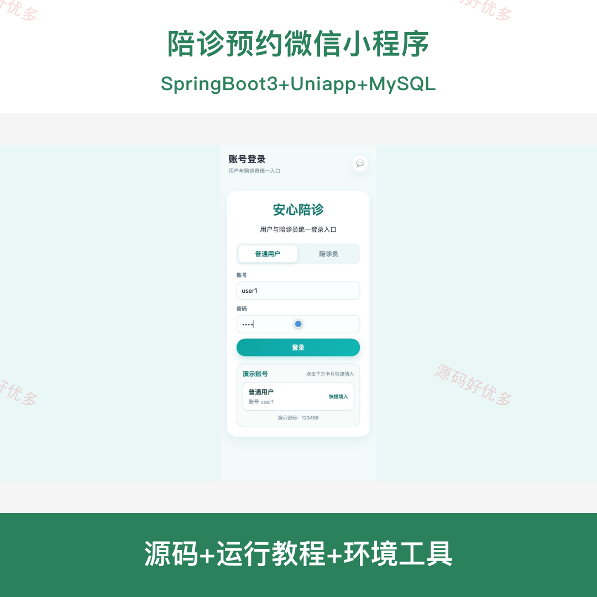
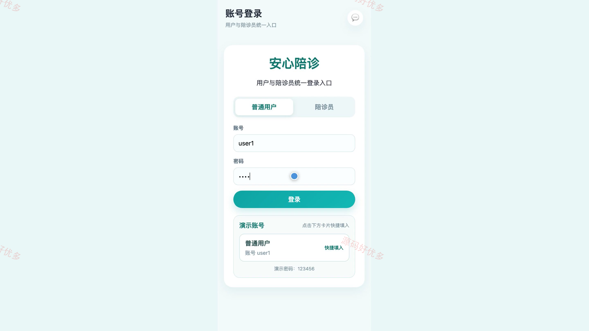
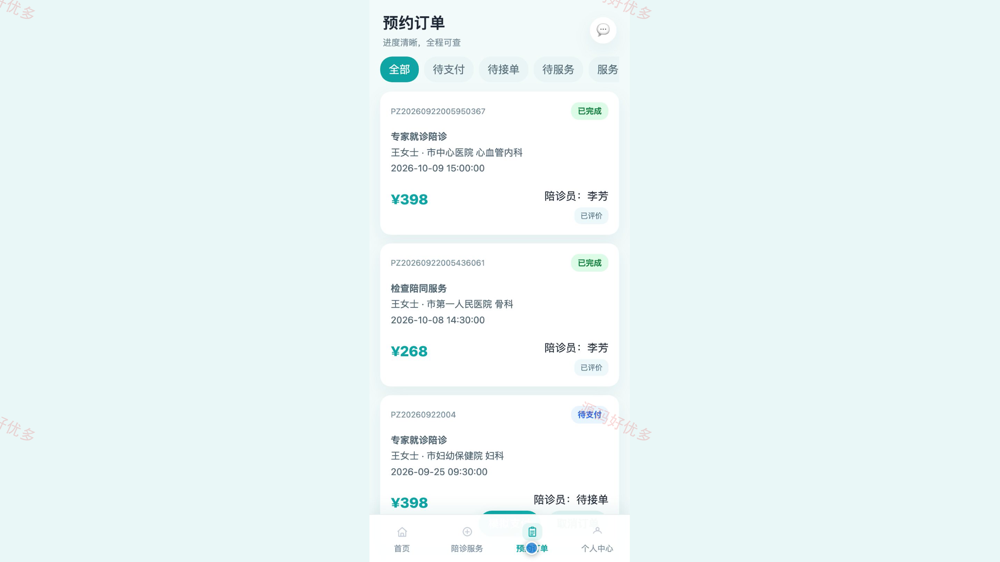
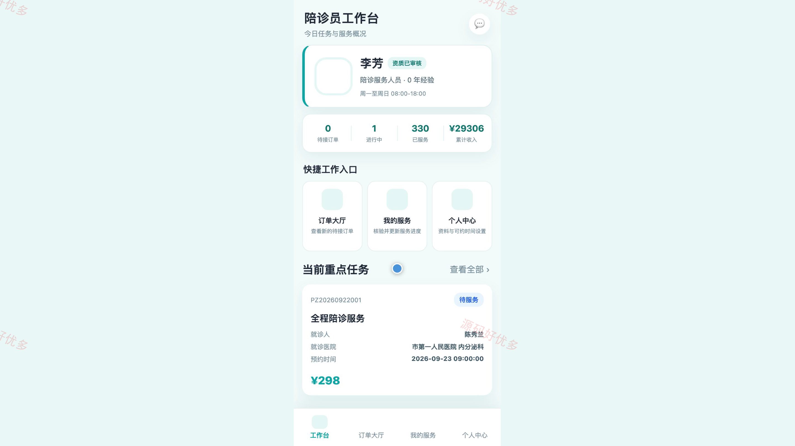
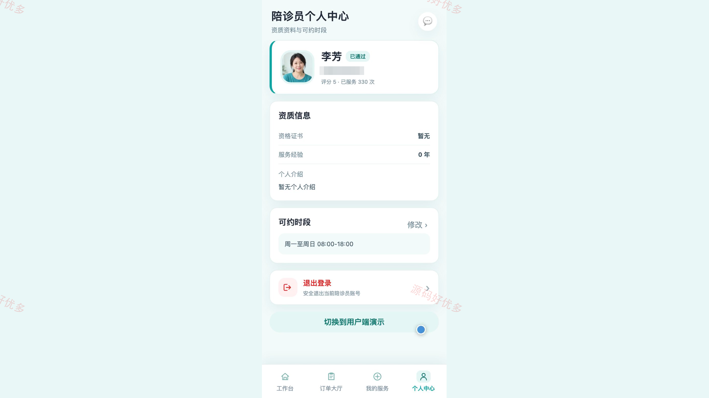
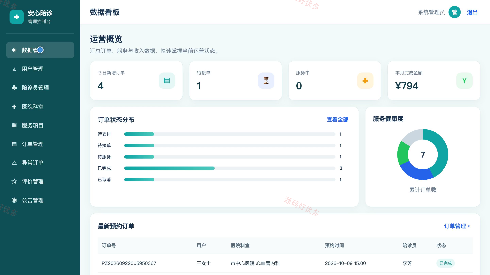
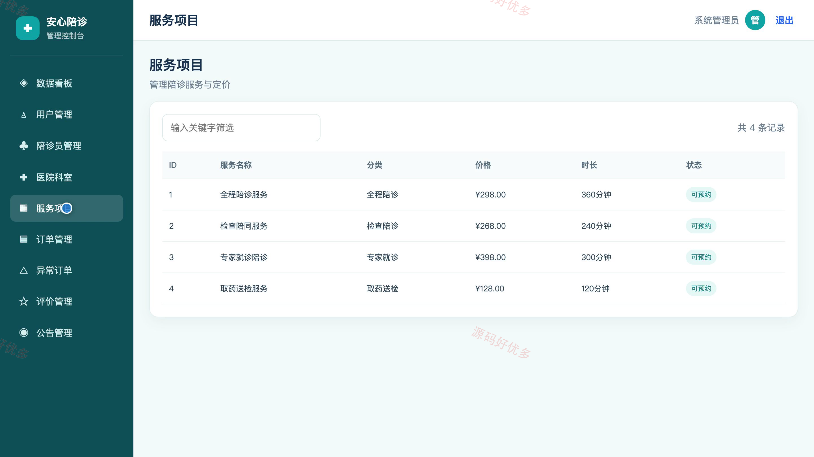
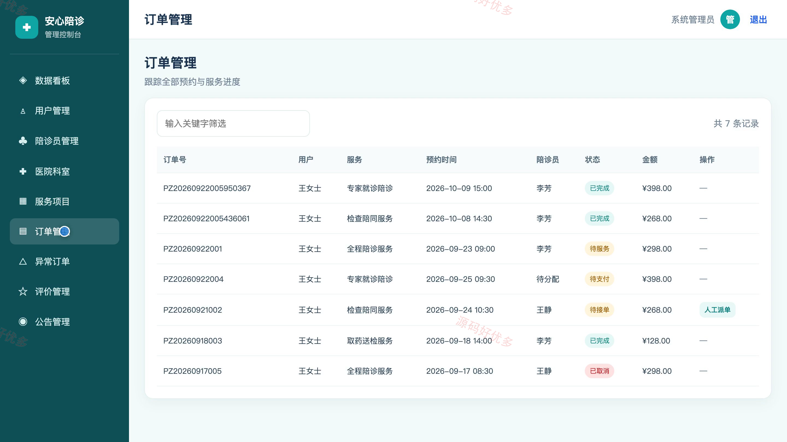

## 源码问题查看主页咨询

### 一、关键词
陪诊预约、就医陪同、医院陪诊、陪护服务、代办取药

### 二、作品包含
源码+数据库+全套环境和工具资源+本地部署教程

### 三、项目技术
前端技术： Html、Css、Js、uniapp
后端技术：Java、SpringBoot3.2.12

### 四、运行环境要求
开发工具：IDEA/eclipse + VSCODE + HBuilder X + 微信开发者工具

数据库：MySQL5.7+（共10张表）

数据库管理工具：Navicat10以上版本

环境配置软件： JDK17 + Maven3.6+

前端Nodejs：18+

浏览器：谷歌浏览器

### 五、项目介绍
项目编号：bs135B

面向就诊用户、陪诊员和平台管理员的陪诊服务系统。小程序提供服务浏览、订单查询与陪诊员接单，配套 H5 演示端提供完整预约流程，管理端处理人员审核、订单派单与服务配置。

角色：用户、陪诊员、管理员

用户功能：浏览陪诊服务与服务详情、查看陪诊员和平台公告、维护就诊人资料、通过 H5 演示端提交预约、查询陪诊订单与进度、模拟支付待付款订单、评价已完成的服务。

陪诊员功能：查看待接订单并接单、查看个人服务记录、核验到场服务码、更新陪诊服务进度、维护可约时段与个人资料、查看服务统计。

管理员功能：查看预约与收入统计、管理用户账号、审核陪诊员资质、维护医院科室与陪诊服务、跟踪订单并人工派单、处理异常订单与评价、发布平台公告。

### 六、运行截图

